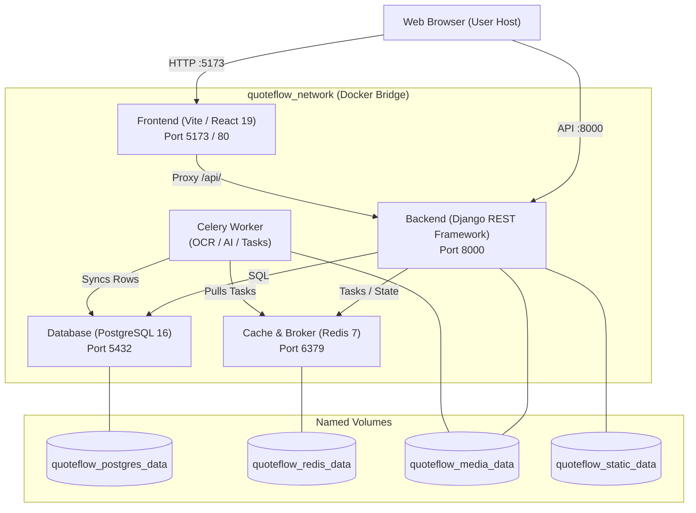

# QuoteFlow AI — Docker Architecture & Deployment Guide

This guide details the Docker containerization setup for **QuoteFlow AI**, a full-stack, AI-powered procurement quotation analysis platform.

---

## Architecture Overview

QuoteFlow AI runs as five isolated, containerized services communicating over an internal Docker bridge network:



---

## Services & Ports

| Service | Container Name | Image / Base | Internal Port | Host Port | Purpose |
|:---|:---|:---|:---|:---|:---|
| **db** | `quoteflow_db` | `postgres:16-alpine` | `5432` | `5432` | Relational database storage |
| **redis** | `quoteflow_redis` | `redis:7-alpine` | `6379` | `6379` | Celery broker & result backend |
| **backend** | `quoteflow_backend` | `python:3.11-slim` | `8000` | `8000` | Django REST API server |
| **celery_worker** | `quoteflow_celery_worker` | `python:3.11-slim` | N/A | N/A | Background OCR, AI parsing & reports |
| **frontend** | `quoteflow_frontend` | `node:20-alpine` | `5173` | `5173` | React + Vite UI with Hot Reloading |

---

## Environment Configuration

QuoteFlow AI uses a unified `.env` file at the root of the workspace. Credentials are **never** hardcoded into Docker images.

### Step 1: Create your `.env` file
```bash
# Linux / macOS:
cp .env.example .env

# Windows (PowerShell):
Copy-Item .env.example .env
```

### Key Environment Variables

```env
# Mode
DJANGO_ENV=development
DEBUG=True

# Security
SECRET_KEY=your_secure_random_key_here

# PostgreSQL
POSTGRES_DB=quoteflow_db
POSTGRES_USER=postgres
POSTGRES_PASSWORD=postgres_secure_password
DB_PORT=5432

# Redis & Celery
REDIS_PORT=6379
CELERY_BROKER_URL=redis://redis:6379/0
CELERY_RESULT_BACKEND=redis://redis:6379/0
CELERY_TASK_ALWAYS_EAGER=False

# Google Gemini AI API (Backend Only)
GEMINI_API_KEY=your_gemini_api_key_here
GEMINI_MODEL_NAME=gemini-2.5-flash

# Frontend & CORS
VITE_API_BASE_URL=http://localhost:8000/api
CORS_ALLOWED_ORIGINS=http://localhost:5173,http://127.0.0.1:5173
CSRF_TRUSTED_ORIGINS=http://localhost:5173,http://127.0.0.1:5173
```

---

## Quickstart Commands

### 1. Build and Start All Services
```bash
docker-compose up --build
```
Add `-d` to run in the background (detached mode):
```bash
docker-compose up --build -d
```

### 2. Verify Running Containers & Health
```bash
docker-compose ps
```

### 3. Accessing the Application
- **Frontend Web UI:** [http://localhost:5173](http://localhost:5173)
- **Django REST API:** [http://localhost:8000/api/](http://localhost:8000/api/)
- **Django Admin:** [http://localhost:8000/admin/](http://localhost:8000/admin/)

---

## Stopping & Managing Containers

### Stop Containers (Preserving Data Volumes)
```bash
docker-compose stop
```

### Stop and Remove Containers & Networks
```bash
docker-compose down
```

### Stop and Wipe All Data Volumes (Clean Slate Reset)
```bash
docker-compose down -v
```

---

## Common Debugging & Inspection Commands

### 1. Tail Live Logs Across All Services
```bash
docker-compose logs -f
```

### 2. Tail Logs for a Specific Service
```bash
# Backend logs
docker-compose logs -f backend

# Celery worker logs (document OCR & AI extraction)
docker-compose logs -f celery_worker

# Database logs
docker-compose logs -f db

# Frontend dev server logs
docker-compose logs -f frontend
```

### 3. Open an Interactive Shell inside a Container
```bash
# Django container bash shell
docker-compose exec backend bash

# PostgreSQL interactive psql client
docker-compose exec db psql -U postgres -d quoteflow_db

# Redis interactive CLI
docker-compose exec redis redis-cli
```

### 4. Create a Django Superuser inside Docker
```bash
docker-compose exec backend python manage.py createsuperuser
```

### 5. Run Database Migrations Manually
*(Note: Migrations run automatically on backend startup via `entrypoint.sh`)*
```bash
docker-compose exec backend python manage.py migrate
```

### 6. Run Test Suites inside Docker
```bash
# Run Django backend test suite
docker-compose exec backend python manage.py test core.test_security_review core.test_comprehensive_suite

# Run Frontend unit & integration tests
docker-compose exec frontend npm run test
```

---

## Production Deployment

A production-optimized Compose file is included: `docker-compose.prod.yml`.
This configuration:
- Builds the frontend into static production bundles served via Nginx.
- Enables Gunicorn for the backend.
- Sets `DEBUG=False`.
- Collects all static files into `quoteflow_prod_static_data`.

To run in production mode:
```bash
docker-compose -f docker-compose.prod.yml up --build -d
```
